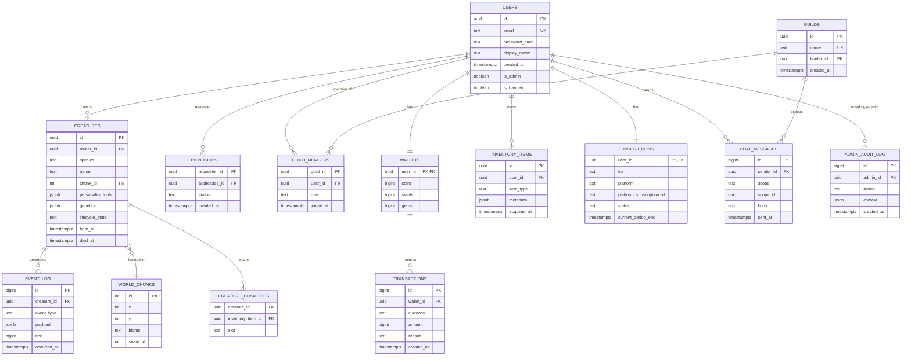

# Database Design

Status: Draft v0.1 · Owner: Database Architecture · Engine: PostgreSQL (via Prisma) + Redis (hot/ephemeral state) · Traces: [Software Requirements Specification](../03_SOFTWARE_ARCHITECTURE/SoftwareRequirements.md)

## 1. Design Principles

- **PostgreSQL is the durable source of truth**; Redis holds hot simulation state, caches, and pub/sub — never the sole copy of anything that must survive a restart.
- **Normalized to 3NF** for transactional/social/economy data. The simulation's per-tick entity state is intentionally *not* fully normalized into per-tick rows (that would be write-amplification suicide) — see §6 for the checkpoint model.
- **Sharding-ready:** tables that will eventually need to scale past a single Postgres instance (`entities`, `event_log`) use a `chunk_id`/`world_shard_id`-first key design so a future shard split is a routing change, not a schema rewrite.
- **Every write path from the API must validate ownership/authorization at the query layer** (e.g., `WHERE creature.owner_id = :userId`), never trust a client-supplied owner field.

## 2. Entity-Relationship Diagram (Core Schema)

## 3. Table Notes, Constraints & Indexes

### 3.1 `users`

- `email` unique, case-insensitive index (`citext` or `lower(email)` unique index).
- `password_hash` nullable when the account is OAuth-only.
- Constraint: `is_banned = true` rows are excluded from all public read paths via a `banned_at IS NULL` filter pattern or a Postgres row-level policy — decision deferred to implementation, but the exclusion must be enforced at the query/service layer consistently, not per-endpoint ad hoc.

### 3.2 `creatures`

- Index: `(owner_id)`, `(chunk_id)` (for spatial queries), partial index `(lifecycle_state) WHERE lifecycle_state != 'dead'` (hot path only queries living creatures).
- `personality_traits` and `genetics` stored as `jsonb` — these are read/written wholesale by the simulation engine, not queried column-by-column, so relational decomposition would add join cost with no query benefit.
- Foreign key `owner_id -> users.id` is nullable to represent wild/unowned creatures (per [Simulation Design §2.1](../02_GAME_DESIGN/Simulation.md), `Ownership` is nullable).
- Trigger: on `lifecycle_state` transition to `dead`, insert a memorial `event_log` row and set `died_at` — enforced via a Postgres trigger (not just application code) so death-memorial creation can't be bypassed by a direct/bulk update.

### 3.3 `world_chunks`

- Unique constraint on `(x, y)`.
- Index on `shard_id` — this is the field that turns "add a shard" into a routing/read-replica decision rather than a schema migration (traces [Architecture §5](../03_SOFTWARE_ARCHITECTURE/Architecture.md), NFR-SCAL-001).

### 3.4 `event_log`

- **Append-only.** No updates, no deletes (deletion only via retention job, see §5).
- Partitioned by `occurred_at` (monthly range partitions) — this table has the highest write volume in the system (one row per significant creature action across potentially millions of entities) and time-range partitioning keeps both writes and the common "recent history" read pattern fast, and makes retention/archival a cheap partition-drop instead of a row-by-row delete.
- Index: `(creature_id, occurred_at DESC)` for the diary/history read path (FR-CRE-003).

### 3.5 `guilds` / `guild_members`

- `guild_members` primary key `(guild_id, user_id)`; `role` constrained via check (`member`, `officer`, `leader`).
- A user may belong to at most one guild in MVP — enforced via unique index on `guild_members.user_id`.

### 3.6 `friendships`

- Composite PK `(requester_id, addressee_id)`; `status` (`pending`, `accepted`, `blocked`). Application layer enforces a canonical direction to prevent duplicate reverse rows (e.g., always store the lower UUID as `requester_id` for accepted relationships, or maintain a `is_mutual` derived read).

### 3.7 `wallets` / `transactions`

- `wallets` is the current-balance table (one row per user); `transactions` is the append-only ledger.
- **Invariant:** wallet balance must always equal the sum of its transactions — enforced at the application layer via a single DB transaction per balance change (update `wallets` + insert `transactions` atomically), never a bare `UPDATE wallets SET coins = coins + :n` without a corresponding ledger row. This is the anti-fraud/audit backbone for FR-ECO-002.
- Index: `(wallet_id, created_at DESC)` on `transactions`.

### 3.8 `subscriptions`

- One row per user (`user_id` PK). `platform_subscription_id` unique per platform — this is the join key for reconciling Apple/Google server-to-server billing webhooks (FR-PAY-003); subscription status here is the entitlement source of truth, never client-reported state.

### 3.9 `chat_messages`

- `scope` enum (`global`, `guild`, `dm`); `scope_id` nullable/contextual (guild id, DM conversation id, null for global).
- Partitioned or TTL-archived similarly to `event_log` if global chat volume warrants it post-launch (defer until real volume data exists — avoid premature partitioning of a table that may stay small).

### 3.10 `admin_audit_log`

- Append-only, no update/delete path exposed at all (traces NFR-SEC-004 / FR-ADM-003). Every admin/moderation mutation must write one row here as part of the same transaction as the mutation itself.

## 4. Views

- `v_creature_public_profile` — joins `creatures` + `creature_cosmetics` + latest `event_log` entries, used by the public creature-detail read path so the API layer doesn't hand-assemble this join per endpoint.
- `v_leaderboard_snapshot` — materialized view, refreshed on a scheduled job (not on every read), backing FR-SOC-004; materialization is required because leaderboard ranking queries over a large creature table are too expensive to run live per request.

## 5. Data Retention & Archival

- `event_log` partitions older than the product-defined "full history" window (e.g., 12 months, TBD by Product) are archived to MinIO as Parquet/CSV export and the Postgres partition is dropped — keeps the operational table bounded regardless of world age, while premium "historical analytics" (FR-PAY-002) can still serve older data from cold storage.
- `admin_audit_log` and `transactions` are retained indefinitely (compliance/audit requirement) — never subject to the same drop-partition retention policy as `event_log`.

## 6. Simulation State: Checkpoint Model (Redis <-> PostgreSQL)

The simulation engine ([Architecture §5](../03_SOFTWARE_ARCHITECTURE/Architecture.md)) keeps live entity component state in-memory/Redis for tick-rate performance, and checkpoints to PostgreSQL (`creatures` and related tables) on a configurable interval (e.g., every N ticks or every X seconds) rather than writing every tick to Postgres. This is a deliberate write-amplification tradeoff: per-tick Postgres writes at millions-of-entities scale are not viable, whereas periodic checkpoint + append-only `event_log` for *significant* events gives durability without paying full-fidelity write cost for every micro-movement.

## 7. Future Sharding Strategy

When a single Postgres instance becomes the bottleneck, `world_chunks.shard_id` and the corresponding `chunk_id` foreign keys on `creatures`/spatial tables are the partition key: shard by contiguous chunk ranges (a shard owns a geographic region of the world), route simulation workers and their checkpoint writes to the corresponding shard's database, and keep cross-shard-rare tables (`users`, `wallets`, `subscriptions`) on a central instance or a separately-scaled service. This is called out at design time specifically so `chunk_id` is never treated as an optional/denormalizable field in implementation.

## 8. Related Documents

- [Software Requirements Specification](../03_SOFTWARE_ARCHITECTURE/SoftwareRequirements.md)
- [Architecture](../03_SOFTWARE_ARCHITECTURE/Architecture.md)
- [API Specification](../05_API/APISpecification.md)
